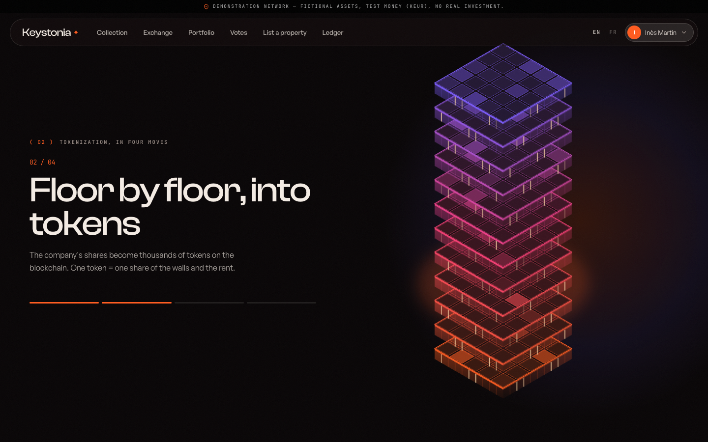
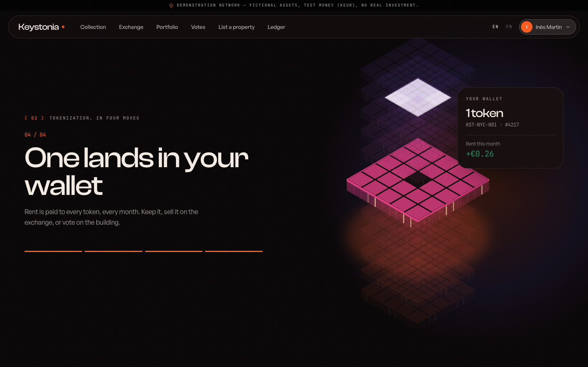
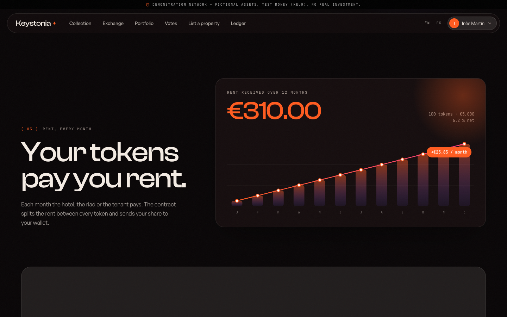
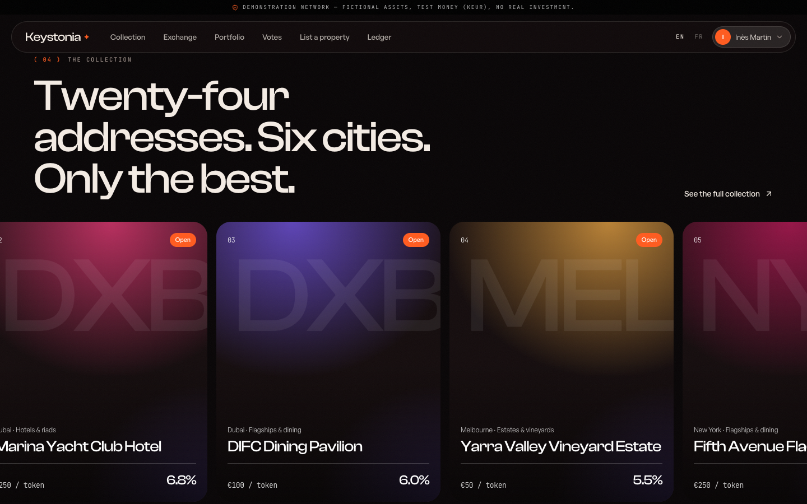
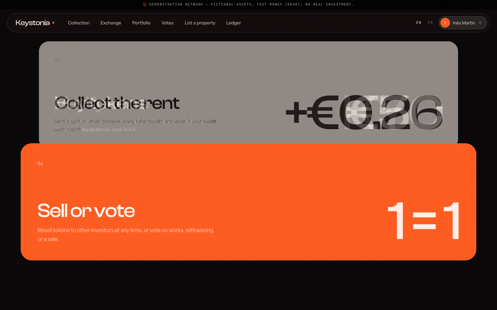
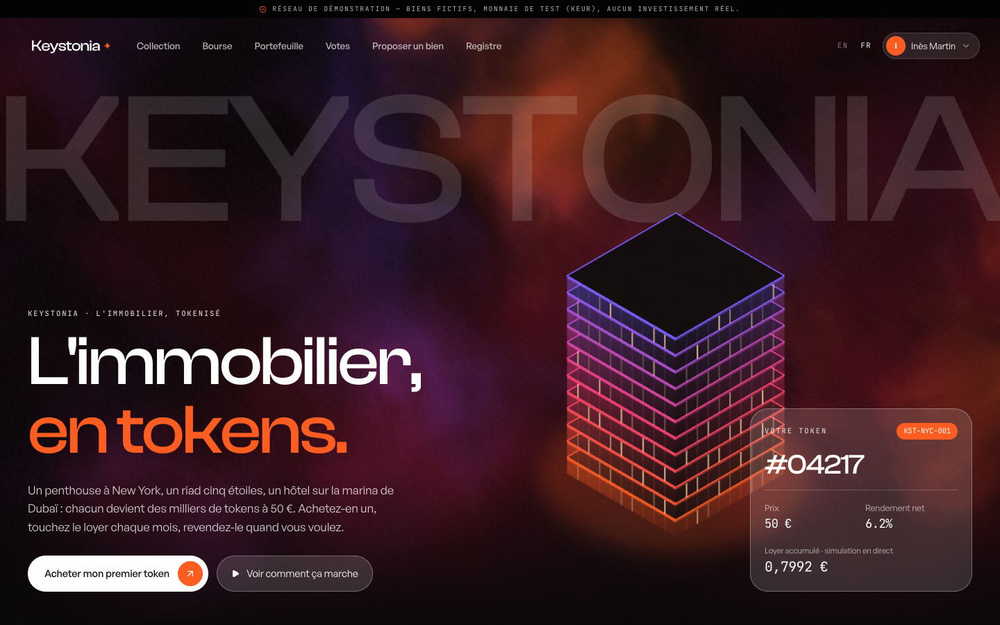
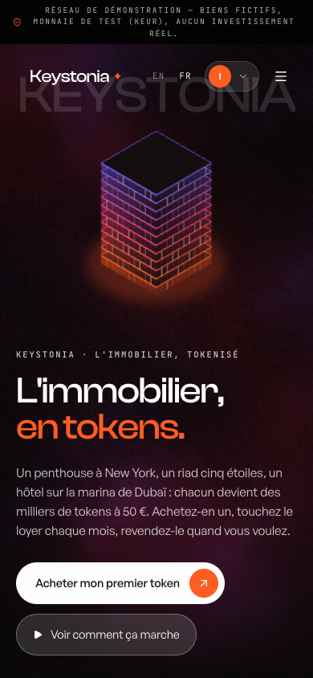

# Keystonia

**Luxury real estate, tokenized: New York, Paris, Dubai, London, Marrakech and Melbourne, from contracts to a cinematic web app.**

### ▶ [Open the live demo](https://egberr.github.io/keystonia/) — runs in your browser, nothing to install

Keystonia turns buildings into tokens. Each fictional property sits in its own company (SPV), and the company's
shares become 20,000 tokens of €50. Verified investors buy them in all-or-nothing offerings, collect the rent every
month, resell tokens peer-to-peer and vote on decisions about the building. Every rule (who may hold a token,
refunds, rent splits, quorum) is enforced by smart contracts, every property opens as a 360° visit made of real
photographs, and an AI analyst answers questions with citations to the property's documents.

> **Demonstration project.** Assets are fictional, money is a test token (kEUR), identity checks are simulated and no
> document is collected. Nothing here is an offer to invest. The live demo replays a snapshot of the local chain and
> simulates transactions in your browser; the full stack (Foundry contracts, API, indexer) runs locally.


| | |
| --- | --- |
|  |  |
|  |  |
|  |  |
|  |  |
|  |  |

## What it does

| Area | Details |
| --- | --- |
| **Catalogue** | 24 luxury assets, €515M tokenized, 6 cities × 5 asset classes (residences, five-star hotels and riads, flagships and dining, resorts, estates). Each asset has a memorandum, a valuation report, a technical survey and a legal note (96 documents). |
| **Valuations from open data** | Paris residences are priced from DVF 2024 transactions (median €/m² by postcode), London residences from HM Land Registry 2024 price-paid data. Hotels, resorts, retail and estates capitalise their income; New York, Dubai, Melbourne and Marrakech figures are flagged as indicative. |
| **Primary offerings** | All-or-nothing sales held in escrow by the offering contract. Sold out or deadline reached → settle (1% fee) and shares are claimable; target missed → full refund. |
| **Compliance** | ERC-3643-style checks inside the token's `_update`: only verified wallets can receive shares on *any* path, per-asset country blocks (U.S. persons blocked, Reg S), holder cap, frozen wallets, agent forced transfers. |
| **Monthly income** | Rent is distributed pro rata with a dividend-per-share accumulator (no loops, any number of holders) and claimed from the portfolio. |
| **Secondary market** | Non-custodial order book: listings stay in the seller's wallet, purchases settle shares and kEUR in one transaction, compliance re-checked on every trade. |
| **Governance** | One share, one vote at a snapshot one second before the proposal opens (so later buys cannot swing a vote), 1% proposal threshold, 20% quorum. |
| **Issuer flow** | Owners submit a listing request on-chain; the operator approves or rejects it with a note. |
| **AI analyst** | Claude with tool use (`search_documents`, `get_asset`, `list_assets`, `compare_assets`) over BM25 retrieval and live indexed chain data. Answers cite passages `[S1]` and datasets `[D1]`, shown with their evidence. Without an API key, a rule-based offline analyst streams the same events. |
| **History** | The seed replays ~13 months of activity (about 3,000 transactions in ~25 s): KYC, offerings, monthly rent, claims, trades, votes and listing requests, using `evm_setNextBlockTimestamp`. |
| **360° visits from real photographs** | Every property opens as a WebGL 360° visit through four rooms or places, built from real equirectangular photographs (62 CC0 captures from Poly Haven). Progressive loading (1K then 4K), crossfade with a lens push between rooms, drag with inertia, auto-play, fullscreen. Card photos are real stills of the same places. |
| **Tokenization, shown** | The home page is pure motion graphics on black: a building drawn as glowing isometric floors is pinned to the scroll, the floors lift apart, every cell becomes a €50 token, and one of them lands in a wallet with its monthly rent. An animated chart then draws twelve months of rent. |
| **Motion everywhere** | GSAP + ScrollTrigger + SplitText and Lenis smooth scrolling: preloader, masked headline reveals, pinned horizontal collection rail, stacking cards, count-ups, parallax, magnetic buttons, page transitions. `prefers-reduced-motion` collapses everything to the final state. |
| **Design** | Night home page with a WebGL colour field (burgundy, orange, violet) and no photography; daylight paper pages inside. Real photographs appear only on property pages. Clash Display + General Sans, one signal orange reserved for tokens. English and French, responsive down to phone width. |
| **Public static demo** | `NEXT_PUBLIC_STATIC=1` exports the app for GitHub Pages: it reads a JSON snapshot of the API (`backend/app/export_static.py`), simulates investing, trading, rent, votes and KYC in the browser (`web/src/lib/demo.ts`), and runs the offline analyst client-side. Deployed by `.github/workflows/pages.yml`. |

## Architecture

```
contracts/   Solidity 0.8.31 · OpenZeppelin 5 · Foundry      40 tests, 96.9% line coverage
backend/     Python 3.12 · FastAPI · web3.py · SQLite indexer · Anthropic SDK
web/         Next.js 16 · React 19 · Tailwind v4 · GSAP · Lenis · React Three Fiber · viem · Recharts · Leaflet
scripts/     catalogue builder, open-data market reference, image fetcher, chain reset
data/        catalogue + generated documents, market reference (chain state is local only)
```

```
 Browser (viem) ── signs txs with demo or injected wallet ──▶ Anvil :8545
     │                                                         │ logs
     └── /api (Next rewrite) ──▶ FastAPI :8000 ◀── indexer thread (SQLite, 1 s)
                                      │
                                      └── Claude analyst ── tools ── BM25 docs + indexed chain data
```

The browser talks to the chain directly for writes, so every action in the UI is a real transaction. The API is
read-only apart from three demo endpoints that stand in for the operator: the KYC desk, the kEUR faucet and a
"next month" clock that distributes rent and settles ended offerings.

| Contract | Role |
| --- | --- |
| `KEUR` | 6-decimal test euro with a daily faucet |
| `IdentityRegistry` | wallet → country, tier, expiry |
| `AssetToken` | one per asset: compliance, income distribution, votes |
| `Offering` | escrowed all-or-nothing primary sale |
| `Marketplace` | non-custodial secondary market |
| `AssetRegistry` | listed assets, listing requests, valuations |
| `AssetGovernor` | proposals and snapshot voting for every asset |

## Run it locally

Requires [Foundry](https://getfoundry.sh), [uv](https://docs.astral.sh/uv/) and [pnpm](https://pnpm.io).

```bash
make install   # forge build, uv sync, pnpm install
make chain     # fresh Anvil + 13 months of history (~20 s)
make api       # http://localhost:8000
make web       # http://localhost:3000
```

`make resume` restarts Anvil from the saved state instead of replaying history. Copy `.env.example` to `.env` and set
`ANTHROPIC_API_KEY` to switch the analyst from offline mode to Claude.

You start as **Inès Martin**, a verified investor with a small portfolio. The wallet menu (top right) switches between
30 investor and 8 issuer profiles, including two U.S. persons the contracts refuse, or connects a browser wallet to
the local chain. Things to try:

1. Invest in a live offering, then open **Transparency → Simulate next month** and claim the rent.
2. List shares on the secondary market and buy them back with another profile.
3. Vote on an open proposal, or submit a new asset from **List an asset** with an issuer profile.
4. Ask the analyst on any asset page how its valuation was built.

## Tests

```bash
make test
```

- **Contracts** — 40 Foundry tests: compliance on every transfer path, offering success/failure/refund, income
  accounting across transfers, marketplace fees, snapshot voting and quorum.
- **Backend** — 64 pytest tests: catalogue economics (shares tile valuation, net below gross yield), document coverage,
  retrieval, and end-to-end API checks against the seeded chain, including the streamed offline analyst.
- **Web** — TypeScript strict, ESLint, production build.

CI runs all three, seeding a fresh chain for the backend job.

## Data and credits

- DVF 2024 (data.gouv.fr, Licence Ouverte 2.0) and HM Land Registry Price Paid Data 2024 (OGL v3.0) for the Paris and
  London market references.
- Photos and 360° panoramas: [Poly Haven](https://polyhaven.com) (CC0), fetched by `scripts/fetch_panoramas.py` and
  listed on `/credits`. They are real places used to illustrate fictional assets; none of the assets exists.
- Fonts: Clash Display and General Sans by the Indian Type Foundry (Fontshare free licence), JetBrains Mono (OFL).
- Map tiles © OpenStreetMap contributors.

## Legal note

Keystonia is an educational portfolio project. Offering real tokenized securities requires, among other things, a
licensed issuer or platform (in the EU, a prospectus or an exemption, and MiFID II or ECSP authorisation), real KYC/AML
and a custody setup. None of that is implemented, and the platform cannot move real money.

MIT licensed.
