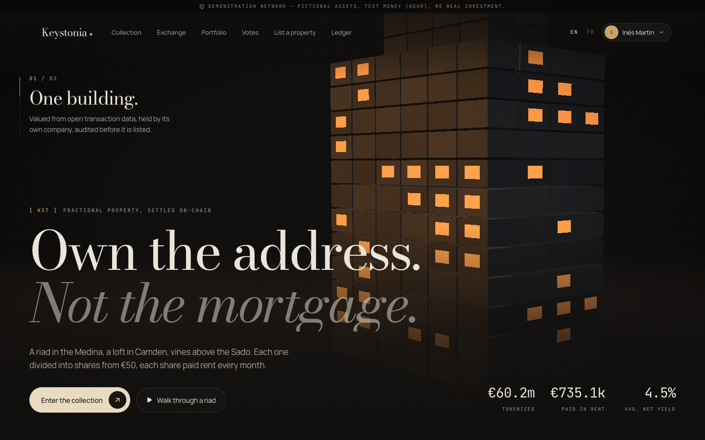
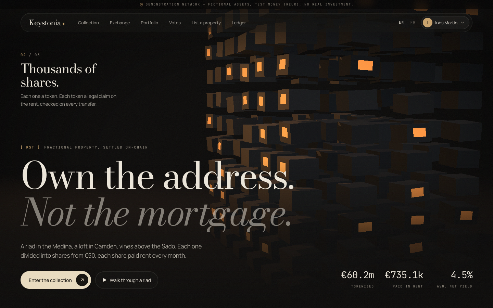
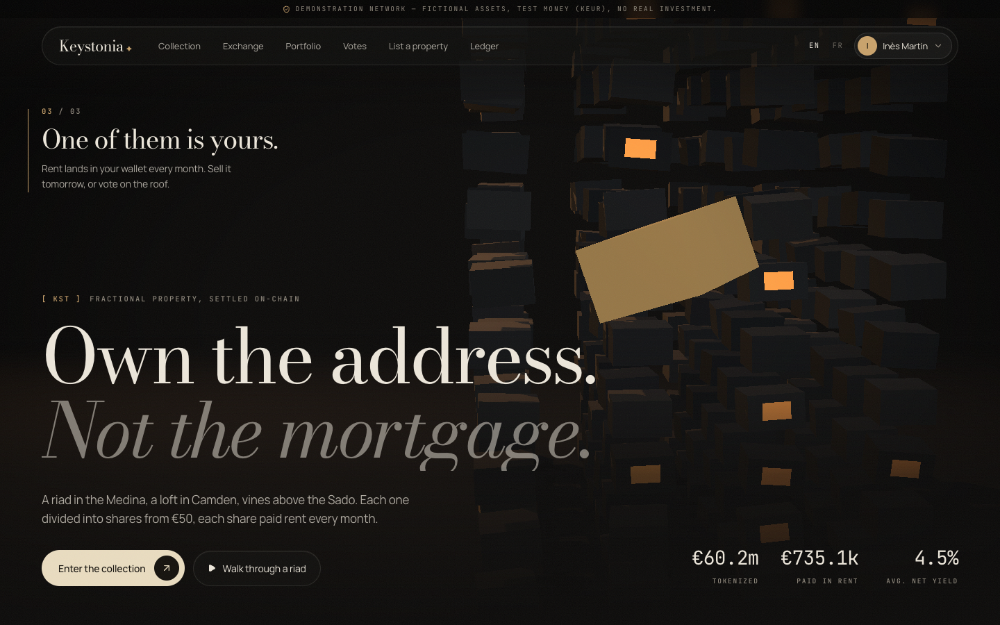
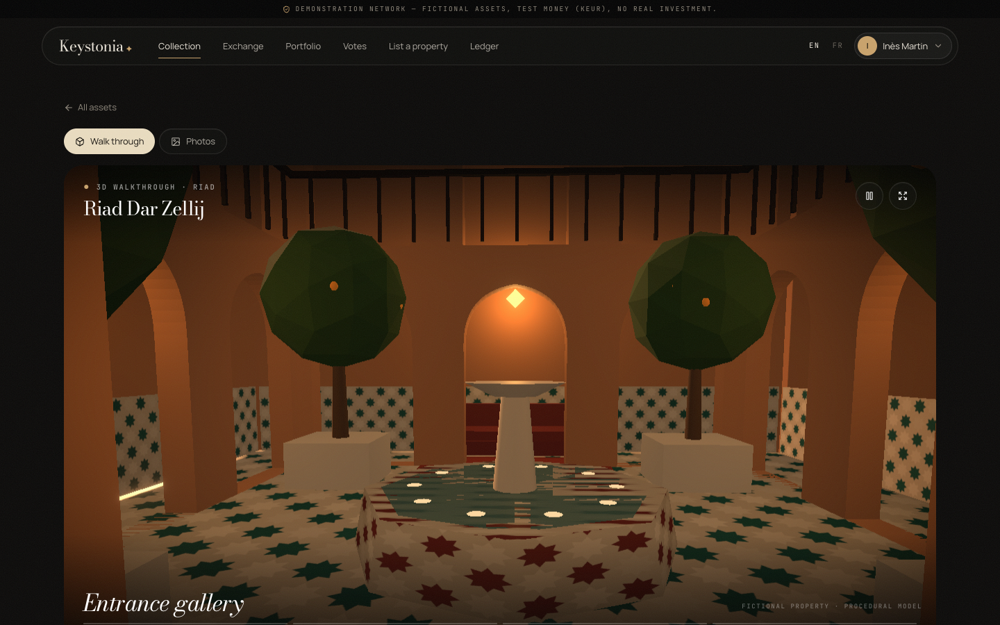
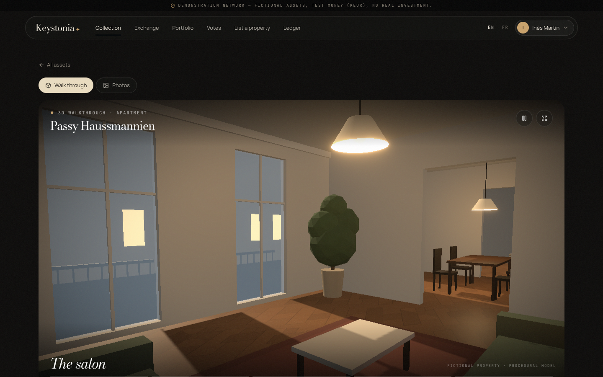
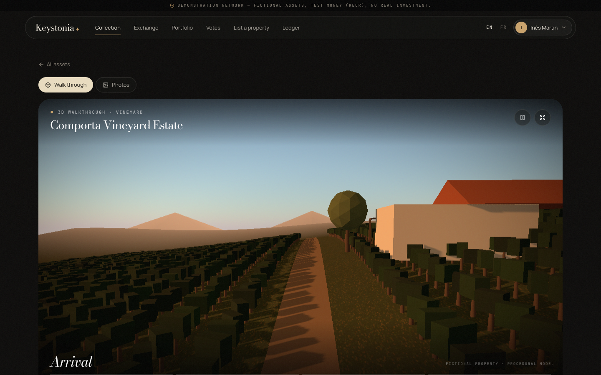
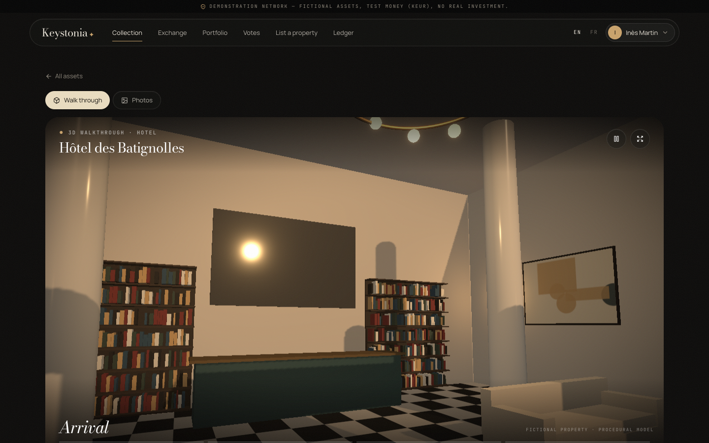
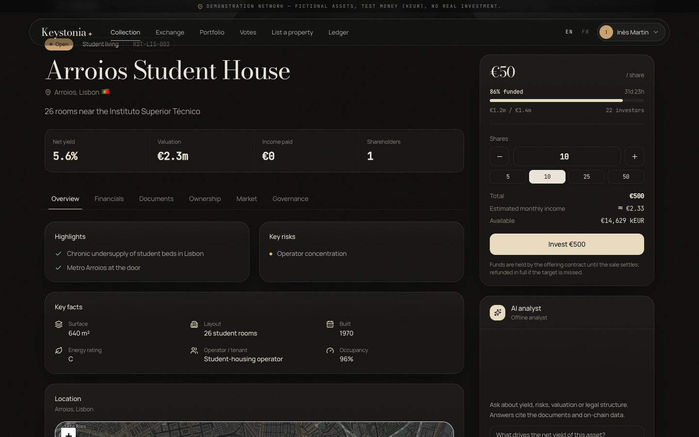
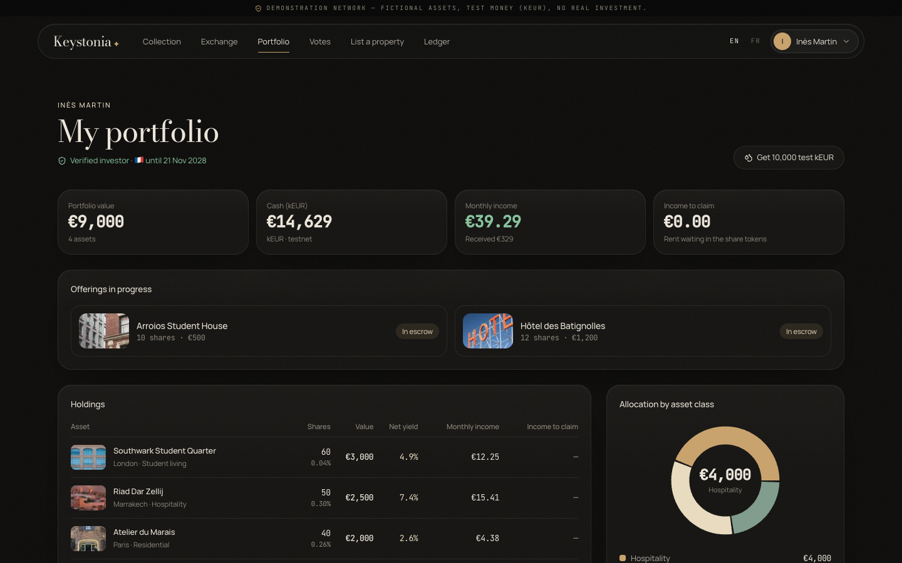
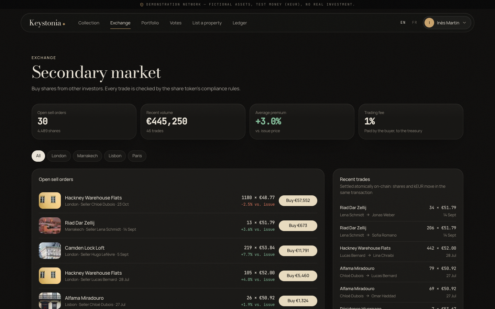

# Keystonia

**Tokenized real estate across Paris, London, Marrakech and Lisbon — full stack, on a local chain.**

Keystonia splits apartments, boutique hotels, shops, student residences and vineyards into on-chain shares from €50.
Verified investors buy into all-or-nothing offerings, receive rent every month, trade shares peer-to-peer and vote on
decisions about each asset. Every rule (who may hold a share, refunds, rent splits, quorum) is enforced by smart
contracts, and an AI analyst answers questions with citations to each asset's documents and on-chain data.

> **Demonstration project.** Everything runs on a local Anvil test network. Assets are fictional, money is a test
> token (kEUR), identity checks are simulated and no document is collected. Nothing here is an offer to invest.



The hero is a real-time 3D building made of its own shares. Scrolling turns it into an exploded drawing of
thousands of blocks, then one block leaves the facade in brass: *one of them is yours*.

| | |
| --- | --- |
|  |  |
|  |  |
|  |  |
|  |  |
|  |  |
|  |  |

## What it does

| Area | Details |
| --- | --- |
| **Catalogue** | 24 assets, €60.2M tokenized, 4 cities × 5 asset classes. Each asset has a memorandum, a valuation report, a technical survey and a legal note (96 documents). |
| **Valuations from open data** | Paris assets are priced from DVF 2024 transactions (median €/m² by postcode), London assets from HM Land Registry 2024 price-paid data. Marrakech and Lisbon use capitalised income and are flagged as indicative. |
| **Primary offerings** | All-or-nothing sales held in escrow by the offering contract. Sold out or deadline reached → settle (1% fee) and shares are claimable; target missed → full refund. |
| **Compliance** | ERC-3643-style checks inside the token's `_update`: only verified wallets can receive shares on *any* path, per-asset country blocks (U.S. persons blocked, Reg S), holder cap, frozen wallets, agent forced transfers. |
| **Monthly income** | Rent is distributed pro rata with a dividend-per-share accumulator (no loops, any number of holders) and claimed from the portfolio. |
| **Secondary market** | Non-custodial order book: listings stay in the seller's wallet, purchases settle shares and kEUR in one transaction, compliance re-checked on every trade. |
| **Governance** | One share, one vote at a snapshot one second before the proposal opens (so later buys cannot swing a vote), 1% proposal threshold, 20% quorum. |
| **Issuer flow** | Owners submit a listing request on-chain; the operator approves or rejects it with a note. |
| **AI analyst** | Claude with tool use (`search_documents`, `get_asset`, `list_assets`, `compare_assets`) over BM25 retrieval and live indexed chain data. Answers cite passages `[S1]` and datasets `[D1]`, shown with their evidence. Without an API key, a rule-based offline analyst streams the same events. |
| **History** | The seed replays ~13 months of activity (2,350 transactions in ~20 s): KYC, offerings, monthly rent, claims, trades, votes and listing requests, using `evm_setNextBlockTimestamp`. |
| **3D walkthroughs** | Every property opens as a real-time visit built procedurally from its type: Haussmann enfilade, riad courtyard with zellige and a roof terrace, hotel lobby and suite, student hall, loft offices, vineyard or olive estate at golden hour. Camera paths with chapters, auto-play, drag to look, fullscreen. No 3D files are downloaded: textures are drawn on canvas and furniture is built from primitives. |
| **Cinematic UI** | React Three Fiber hero pinned over 280vh of scroll, bloom and vignette, Bodoni Moda / Manrope / JetBrains Mono, one brass accent on warm black. English and French, responsive down to phone width, `prefers-reduced-motion` respected. Spec in [`docs/design.md`](docs/design.md). |

## Architecture

```
contracts/   Solidity 0.8.31 · OpenZeppelin 5 · Foundry      40 tests, 96.9% line coverage
backend/     Python 3.12 · FastAPI · web3.py · SQLite indexer · Anthropic SDK
web/         Next.js 16 · React 19 · Tailwind v4 · React Three Fiber · viem · Recharts · Leaflet
scripts/     catalogue builder, open-data market reference, image fetcher, chain reset
data/        catalogue + generated documents, market reference (chain state is local only)
```

```
 Browser (viem) ── signs txs with demo or injected wallet ──▶ Anvil :8545
     │                                                         │ logs
     └── /api (Next rewrite) ──▶ FastAPI :8000 ◀── indexer thread (SQLite, 1 s)
                                      │
                                      └── Claude analyst ── tools ── BM25 docs + indexed chain data
```

The browser talks to the chain directly for writes, so every action in the UI is a real transaction. The API is
read-only apart from three demo endpoints that stand in for the operator: the KYC desk, the kEUR faucet and a
"next month" clock that distributes rent and settles ended offerings.

| Contract | Role |
| --- | --- |
| `KEUR` | 6-decimal test euro with a daily faucet |
| `IdentityRegistry` | wallet → country, tier, expiry |
| `AssetToken` | one per asset: compliance, income distribution, votes |
| `Offering` | escrowed all-or-nothing primary sale |
| `Marketplace` | non-custodial secondary market |
| `AssetRegistry` | listed assets, listing requests, valuations |
| `AssetGovernor` | proposals and snapshot voting for every asset |

## Run it locally

Requires [Foundry](https://getfoundry.sh), [uv](https://docs.astral.sh/uv/) and [pnpm](https://pnpm.io).

```bash
make install   # forge build, uv sync, pnpm install
make chain     # fresh Anvil + 13 months of history (~20 s)
make api       # http://localhost:8000
make web       # http://localhost:3000
```

`make resume` restarts Anvil from the saved state instead of replaying history. Copy `.env.example` to `.env` and set
`ANTHROPIC_API_KEY` to switch the analyst from offline mode to Claude.

You start as **Inès Martin**, a verified investor with a small portfolio. The wallet menu (top right) switches between
30 investor and 8 issuer profiles, including two U.S. persons the contracts refuse, or connects a browser wallet to
the local chain. Things to try:

1. Invest in a live offering, then open **Transparency → Simulate next month** and claim the rent.
2. List shares on the secondary market and buy them back with another profile.
3. Vote on an open proposal, or submit a new asset from **List an asset** with an issuer profile.
4. Ask the analyst on any asset page how its valuation was built.

## Tests

```bash
make test
```

- **Contracts** — 40 Foundry tests: compliance on every transfer path, offering success/failure/refund, income
  accounting across transfers, marketplace fees, snapshot voting and quorum.
- **Backend** — 64 pytest tests: catalogue economics (shares tile valuation, net below gross yield), document coverage,
  retrieval, and end-to-end API checks against the seeded chain, including the streamed offline analyst.
- **Web** — TypeScript strict, ESLint, production build.

CI runs all three, seeding a fresh chain for the backend job.

## Data and credits

- DVF 2024 (data.gouv.fr, Licence Ouverte 2.0) and HM Land Registry Price Paid Data 2024 (OGL v3.0) for the Paris and
  London market references.
- Photos: openly licensed images found through the Openverse API, listed with authors and licences on `/credits`.
  They illustrate the fictional assets and do not depict real properties.
- Map tiles © OpenStreetMap contributors.

## Legal note

Keystonia is an educational portfolio project. Offering real tokenized securities requires, among other things, a
licensed issuer or platform (in the EU, a prospectus or an exemption, and MiFID II or ECSP authorisation), real KYC/AML
and a custody setup. None of that is implemented, and the platform cannot move real money.

MIT licensed.
